  <picture>
    <source media="(max-width: 700px) and (prefers-reduced-motion: reduce)" srcset="./assets/xcyt0x-mobile-still.svg">
    <source media="(prefers-reduced-motion: reduce)" srcset="./assets/xcyt0x-banner-still.svg">
    <source media="(max-width: 700px)" srcset="./assets/xcyt0x-mobile.svg">
    
  </picture>

I’m **xCyt0x**. I diagnose faults in **BMW electronic systems**, evaluate control units, and code features that the vehicle supports. I also work on digital projects.

## Projects

- [**KG Premium**](https://kgpremium.com/) — BMW technical content and a [digital shop](https://kgpremium.com/shop) for tools and files.

[Contact](https://kgpremium.com/contact) · [X](https://twitter.com/xCyt0x) · [Instagram](https://www.instagram.com/kamranghezavati/) · [Reddit](https://www.reddit.com/user/xCyt0x/)

معرفی به فارسی

من **xCyt0x** هستم. خطاهای سیستم‌های الکترونیکی BMW را بررسی می‌کنم، عملکرد یونیت‌ها را ارزیابی می‌کنم و قابلیت‌های سازگار با خودرو را کدینگ می‌کنم. در کنار کار خودرو، روی پروژه‌های دیجیتال هم کار می‌کنم.

