  <picture><source media="(max-width: 700px) and (prefers-reduced-motion: reduce)" srcset="./assets/profile/identity-mobile-still.svg"><source media="(prefers-reduced-motion: reduce)" srcset="./assets/profile/identity-still.svg"><source media="(max-width: 700px)" srcset="./assets/profile/identity-mobile.svg"></picture>

I’m **xCyt0x**. My work spans **automotive systems and digital projects**. In automotive, I focus on BMW fault analysis, electronic control units, and vehicle coding. I’m exploring other areas before sharing them publicly.

[Projects](#projects) · [Connect](#connect) · [Activity](#activity)

## Projects

  <a href="https://kgpremium.com/"><picture><source media="(prefers-reduced-motion: reduce)" srcset="./assets/profile/project-kg-still.svg"></picture></a>
  <picture><source media="(prefers-reduced-motion: reduce)" srcset="./assets/profile/project-future-still.svg"></picture>

**KG Premium** is where I share technical resources for BMW and offer digital tools through the [shop](https://kgpremium.com/shop). 

## Connect

  <a href="https://kgpremium.com/contact"><picture><source media="(prefers-reduced-motion: reduce)" srcset="./assets/profile/connect-contact-still.svg"></picture></a>
  <a href="https://twitter.com/xCyt0x"><picture><source media="(prefers-reduced-motion: reduce)" srcset="./assets/profile/connect-x-still.svg"></picture></a>
   
  <picture><source media="(prefers-reduced-motion: reduce)" srcset="./assets/profile/connect-rail-still.svg"></picture>
   
  <a href="https://www.instagram.com/kamranghezavati/"><picture><source media="(prefers-reduced-motion: reduce)" srcset="./assets/profile/connect-instagram-still.svg"></picture></a>
  <a href="https://www.reddit.com/user/xCyt0x/"><picture><source media="(prefers-reduced-motion: reduce)" srcset="./assets/profile/connect-reddit-still.svg"></picture></a>

## Activity

  <a href="https://github.com/xCyt0x#js-contribution-activity"><picture><source media="(max-width: 700px) and (prefers-reduced-motion: reduce)" srcset="./assets/profile/activity-mobile-still.svg"><source media="(prefers-reduced-motion: reduce)" srcset="./assets/profile/activity-still.svg"><source media="(max-width: 700px)" srcset="./assets/profile/activity-mobile.svg"></picture></a>

معرفی به فارسی

من **xCyt0x** هستم. در زمینهٔ سیستم‌های خودرو و پروژه‌های دیجیتال کار می‌کنم و چند حوزهٔ دیگر را هم در دست بررسی دارم. تحلیل خطاهای BMW، بررسی یونیت‌ها و کدینگ خودرو بخشی از کار من است. [KG Premium](https://kgpremium.com/) یکی از پروژه‌هایم برای انتشار منابع تخصصی و ابزارهای دیجیتال است.

