<!-- Artwork URLs point to the artwork commit so GitHub serves the corresponding SVG bytes. -->

  <picture><source media="(max-width: 700px) and (prefers-reduced-motion: reduce)" srcset="https://raw.githubusercontent.com/xCyt0x/xCyt0x/de115fdc29010513cf84b4de7b10125ce45cdc9a/assets/profile/identity-mobile-still.svg"><source media="(prefers-reduced-motion: reduce)" srcset="https://raw.githubusercontent.com/xCyt0x/xCyt0x/de115fdc29010513cf84b4de7b10125ce45cdc9a/assets/profile/identity-still.svg"><source media="(max-width: 700px)" srcset="https://raw.githubusercontent.com/xCyt0x/xCyt0x/de115fdc29010513cf84b4de7b10125ce45cdc9a/assets/profile/identity-mobile.svg"></picture>

I’m **xCyt0x**. My work spans **automotive systems and digital projects**. I work across vehicle makes, with a focus on BMW fault analysis, electronic control units, and vehicle coding. I’m exploring other areas before sharing them publicly.

[Focus](#focus) · [Projects](#projects) · [Connect](#connect) · [Activity](#activity)

## Focus

  <picture><source media="(max-width: 700px) and (prefers-reduced-motion: reduce)" srcset="https://raw.githubusercontent.com/xCyt0x/xCyt0x/de115fdc29010513cf84b4de7b10125ce45cdc9a/assets/profile/focus-mobile-still.svg"><source media="(prefers-reduced-motion: reduce)" srcset="https://raw.githubusercontent.com/xCyt0x/xCyt0x/de115fdc29010513cf84b4de7b10125ce45cdc9a/assets/profile/focus-still.svg"><source media="(max-width: 700px)" srcset="https://raw.githubusercontent.com/xCyt0x/xCyt0x/de115fdc29010513cf84b4de7b10125ce45cdc9a/assets/profile/focus-mobile.svg"></picture>

## Projects

  <a href="https://kgpremium.com/"><picture><source media="(max-width: 700px) and (prefers-reduced-motion: reduce)" srcset="https://raw.githubusercontent.com/xCyt0x/xCyt0x/de115fdc29010513cf84b4de7b10125ce45cdc9a/assets/profile/project-kg-mobile-still.svg"><source media="(prefers-reduced-motion: reduce)" srcset="https://raw.githubusercontent.com/xCyt0x/xCyt0x/de115fdc29010513cf84b4de7b10125ce45cdc9a/assets/profile/project-kg-still.svg"><source media="(max-width: 700px)" srcset="https://raw.githubusercontent.com/xCyt0x/xCyt0x/de115fdc29010513cf84b4de7b10125ce45cdc9a/assets/profile/project-kg-mobile.svg"></picture></a>
  <picture><source media="(max-width: 700px) and (prefers-reduced-motion: reduce)" srcset="https://raw.githubusercontent.com/xCyt0x/xCyt0x/de115fdc29010513cf84b4de7b10125ce45cdc9a/assets/profile/project-future-mobile-still.svg"><source media="(prefers-reduced-motion: reduce)" srcset="https://raw.githubusercontent.com/xCyt0x/xCyt0x/de115fdc29010513cf84b4de7b10125ce45cdc9a/assets/profile/project-future-still.svg"><source media="(max-width: 700px)" srcset="https://raw.githubusercontent.com/xCyt0x/xCyt0x/de115fdc29010513cf84b4de7b10125ce45cdc9a/assets/profile/project-future-mobile.svg"></picture>

  <picture><source media="(max-width: 700px) and (prefers-reduced-motion: reduce)" srcset="https://raw.githubusercontent.com/xCyt0x/xCyt0x/6877e9284afd1234213d5e369943cdca6a9aaba1/assets/profile/project-factorasion-mobile-still.svg"><source media="(prefers-reduced-motion: reduce)" srcset="https://raw.githubusercontent.com/xCyt0x/xCyt0x/6877e9284afd1234213d5e369943cdca6a9aaba1/assets/profile/project-factorasion-still.svg"><source media="(max-width: 700px)" srcset="https://raw.githubusercontent.com/xCyt0x/xCyt0x/6877e9284afd1234213d5e369943cdca6a9aaba1/assets/profile/project-factorasion-mobile.svg"></picture>

**KG Premium** is where I share technical resources for BMW and offer digital tools through the [shop](https://kgpremium.com/shop). 

- **Automotive work** covers fault analysis, control-unit diagnostics, and vehicle feature configuration. [See selected work](https://kgpremium.com/contact#about).
- **Digital tools and resources** are available through the storefront. [Browse the shop](https://kgpremium.com/shop).
- **Web, support, and community** come together through the KG Premium site, its account library, and its connected Discord community. [Explore KG Premium](https://kgpremium.com/).

More about KG Premium

The site brings together my automotive portfolio, digital product delivery, and customer support. It supports five languages, light and dark themes, and direct contact for automotive enquiries.

**Factorasion · Private beta** is a Windows desktop app for small-business accounting, invoices, and quotes.

## Connect

  <a href="https://kgpremium.com/contact"><picture><source media="(max-width: 700px) and (prefers-reduced-motion: reduce)" srcset="https://raw.githubusercontent.com/xCyt0x/xCyt0x/de115fdc29010513cf84b4de7b10125ce45cdc9a/assets/profile/connect-contact-mobile-still.svg"><source media="(prefers-reduced-motion: reduce)" srcset="https://raw.githubusercontent.com/xCyt0x/xCyt0x/de115fdc29010513cf84b4de7b10125ce45cdc9a/assets/profile/connect-contact-still.svg"><source media="(max-width: 700px)" srcset="https://raw.githubusercontent.com/xCyt0x/xCyt0x/de115fdc29010513cf84b4de7b10125ce45cdc9a/assets/profile/connect-contact-mobile.svg"></picture></a>
  <a href="https://twitter.com/xCyt0x"><picture><source media="(max-width: 700px) and (prefers-reduced-motion: reduce)" srcset="https://raw.githubusercontent.com/xCyt0x/xCyt0x/de115fdc29010513cf84b4de7b10125ce45cdc9a/assets/profile/connect-x-mobile-still.svg"><source media="(prefers-reduced-motion: reduce)" srcset="https://raw.githubusercontent.com/xCyt0x/xCyt0x/de115fdc29010513cf84b4de7b10125ce45cdc9a/assets/profile/connect-x-still.svg"><source media="(max-width: 700px)" srcset="https://raw.githubusercontent.com/xCyt0x/xCyt0x/de115fdc29010513cf84b4de7b10125ce45cdc9a/assets/profile/connect-x-mobile.svg"></picture></a>
   
  <picture><source media="(prefers-reduced-motion: reduce)" srcset="https://raw.githubusercontent.com/xCyt0x/xCyt0x/de115fdc29010513cf84b4de7b10125ce45cdc9a/assets/profile/connect-rail-still.svg"></picture>
   
  <a href="https://www.instagram.com/kamranghezavati/"><picture><source media="(max-width: 700px) and (prefers-reduced-motion: reduce)" srcset="https://raw.githubusercontent.com/xCyt0x/xCyt0x/de115fdc29010513cf84b4de7b10125ce45cdc9a/assets/profile/connect-instagram-mobile-still.svg"><source media="(prefers-reduced-motion: reduce)" srcset="https://raw.githubusercontent.com/xCyt0x/xCyt0x/de115fdc29010513cf84b4de7b10125ce45cdc9a/assets/profile/connect-instagram-still.svg"><source media="(max-width: 700px)" srcset="https://raw.githubusercontent.com/xCyt0x/xCyt0x/de115fdc29010513cf84b4de7b10125ce45cdc9a/assets/profile/connect-instagram-mobile.svg"></picture></a>
  <a href="https://www.reddit.com/user/xCyt0x/"><picture><source media="(max-width: 700px) and (prefers-reduced-motion: reduce)" srcset="https://raw.githubusercontent.com/xCyt0x/xCyt0x/de115fdc29010513cf84b4de7b10125ce45cdc9a/assets/profile/connect-reddit-mobile-still.svg"><source media="(prefers-reduced-motion: reduce)" srcset="https://raw.githubusercontent.com/xCyt0x/xCyt0x/de115fdc29010513cf84b4de7b10125ce45cdc9a/assets/profile/connect-reddit-still.svg"><source media="(max-width: 700px)" srcset="https://raw.githubusercontent.com/xCyt0x/xCyt0x/de115fdc29010513cf84b4de7b10125ce45cdc9a/assets/profile/connect-reddit-mobile.svg"></picture></a>

[Contact](https://kgpremium.com/contact) · [X](https://twitter.com/xCyt0x) · [Instagram](https://www.instagram.com/kamranghezavati/) · [Reddit](https://www.reddit.com/user/xCyt0x/)

## Activity

  <a href="https://github.com/xCyt0x#js-contribution-activity"><picture><source media="(max-width: 700px) and (prefers-reduced-motion: reduce)" srcset="https://raw.githubusercontent.com/xCyt0x/xCyt0x/de115fdc29010513cf84b4de7b10125ce45cdc9a/assets/profile/activity-mobile-still.svg"><source media="(prefers-reduced-motion: reduce)" srcset="https://raw.githubusercontent.com/xCyt0x/xCyt0x/de115fdc29010513cf84b4de7b10125ce45cdc9a/assets/profile/activity-still.svg"><source media="(max-width: 700px)" srcset="https://raw.githubusercontent.com/xCyt0x/xCyt0x/de115fdc29010513cf84b4de7b10125ce45cdc9a/assets/profile/activity-mobile.svg"></picture></a>

The snapshot covers **16 August–14 November 2026 (UTC)**. It uses the totals visible on my public GitHub calendar, including anonymized private contributions. [View my current contribution graph](https://github.com/xCyt0x#js-contribution-activity).

معرفی به فارسی

من **xCyt0x** هستم. در زمینهٔ سیستم‌های خودرو و پروژه‌های دیجیتال کار می‌کنم و چند حوزهٔ دیگر را هم در دست بررسی دارم. روی خودروهای برندهای مختلف کار می‌کنم. تحلیل خطاهای BMW، بررسی یونیت‌ها و کدینگ خودرو بخشی از کار من است. [KG Premium](https://kgpremium.com/) یکی از پروژه‌هایم برای انتشار منابع تخصصی و ابزارهای دیجیتال است.

**فاکتوراسیون · بتای خصوصی** اپلیکیشن ویندوزی حسابداری، فاکتور و پیش‌فاکتور کسب‌وکارهاست.

[نمونه‌کارهای خودرو](https://kgpremium.com/contact#about) · [فروشگاه دیجیتال](https://kgpremium.com/shop) · [راه‌های ارتباط](https://kgpremium.com/contact)

